# はじめに

TUIアプリを開発する時に対応してみたいターミナルの機能やUI/UXをまとめました。
主にOpenTUIのReact APIと`printf`コマンドで紹介します。TSXのコードは、コンポーネント内で使う部分を抜粋しています。

:::message
今回紹介する機能は、ターミナルやその設定によって対応状況が異なります。筆者は主にkittyやGhosttyを用いています。

また、調べきれていない部分や間違っている部分もあるかもしれないのでご了承ください。
:::

文中のOSCやCSIは、色やタイトルなどを操作・問い合わせするために、ターミナルへ送る制御列です。`printf`の例にある`\033`はESC文字、`\007`はBEL文字を表します。

# 機能とUI/UX

## レスポンシブデザイン

ターミナルでもWebなどと同じように、実行中に画面サイズが狭くなったり広くなったりします。
幅に応じて横並びを縦並びにしたり、サイドバーを必要な時だけ開く形にしたりすると、小さい画面でも操作しやすくなります。

OpenTUIでは、以下のように幅と高さを取得できます。画面サイズが変更された場合も、自動的に値が更新されます。単位はピクセルではなく、文字の列数・行数です。

```tsx
import { useTerminalDimensions } from "@opentui/react"

const { width, height } = useTerminalDimensions()
const compact = width < 80
```

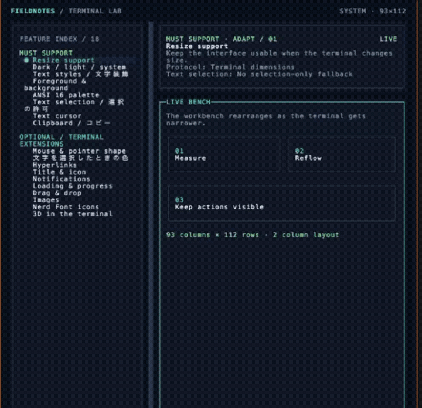

## Dark/Lightテーマ

ターミナルやOSのDark/Lightに合わせて、TUIのテーマを切り替えることができます。
対応するターミナルでは、以下の問い合わせでDark/Lightの設定を取得できます。

```bash
printf '\033[?996n'
# 応答が CSI ?997;1n だったらDark
# 応答が CSI ?997;2n だったらLight
```

応答はターミナルからの入力として返るので、アプリ側で受信する必要があります。シェルで実行すると、入力行に応答が現れる場合があります。

また、`CSI ?2031h`を送ると配色変更の通知を有効にでき、OSの外観を切り替えた時などに追従できます。終了時は`CSI ?2031l`で解除します。[問い合わせと変更通知の仕様](https://contour-terminal.org/vt-extensions/color-palette-update-notifications/)

Ghosttyでターミナルの配色自体をOSに連動させたい場合は、明暗両方のテーマを設定します。[Ghosttyのテーマ設定](https://ghostty.org/docs/features/theme#separate-light-and-dark-themes)

```ini
theme = dark:Catppuccin Frappe,light:Catppuccin Latte
```

OSC 11で既定の背景色を取得し、その明るさからDark/Lightを推定する方法もあります。ただし、これは配色からの推定なので、OSの外観設定と同じとは限りません。

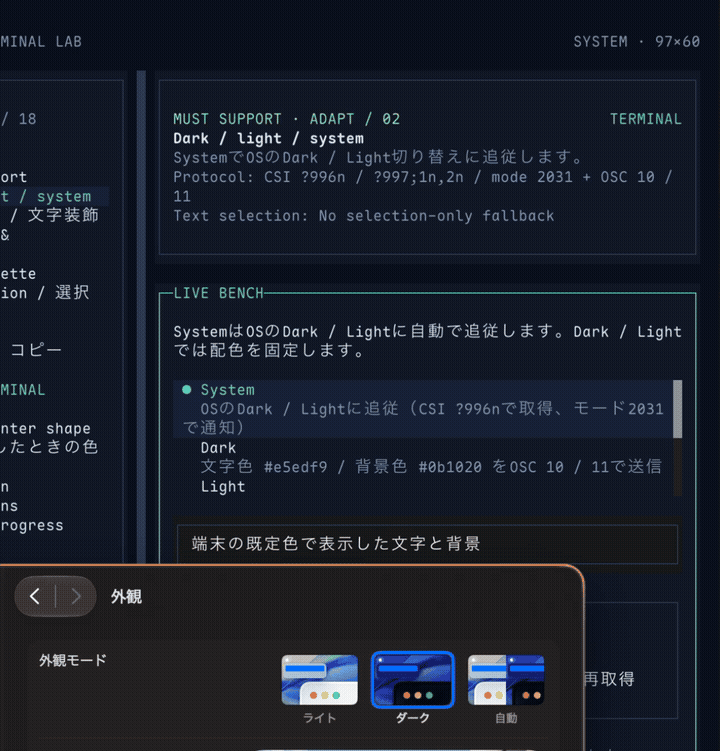

## 太字/下線/斜体などの文字装飾

文字は太字・下線・斜体に加え、取り消し線・薄字・反転・点滅などで装飾できます。
強調したい部分を太字にする、補足を薄字にする、削除済みの項目に取り消し線を付ける、といった使い方ができます。点滅の表示はターミナルや設定によって異なります。

```tsx
import { bold, dim, strikethrough, t } from "@opentui/core"

const text = t`${bold("重要")} ${dim("補足")} ${strikethrough("削除済み")}`
return <text content={text} />
```

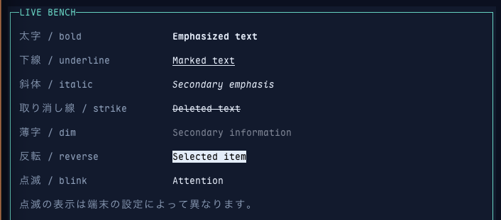

https://opentui.com/docs/components/text/

## 前景色/背景色

前景色は主に文字の色、背景色はその後ろの地の色です。
OSC 10でターミナルの既定の文字色、OSC 11で既定の背景色を変更できます。ただし、アプリが個別に赤や青などを指定した部分は、その指定色を使います。

OpenTUIでターミナルの既定色を使って描く場合は、以下のように指定できます。

```tsx
import { RGBA } from "@opentui/core"

return <box backgroundColor={RGBA.defaultBackground()}>
  <text fg={RGBA.defaultForeground()}>ターミナルの既定の文字色で表示</text>
</box>
```

`RGBA.defaultForeground()`などは、ターミナルへ問い合わせてRGB値を取得する関数ではありません。「ターミナルの既定色を使う」という指定です。実際のRGB値が必要なら、`await renderer.getPalette()`の`defaultForeground` / `defaultBackground`を参照します。[OpenTUIの色の扱い](https://opentui.com/docs/core-concepts/colors/)

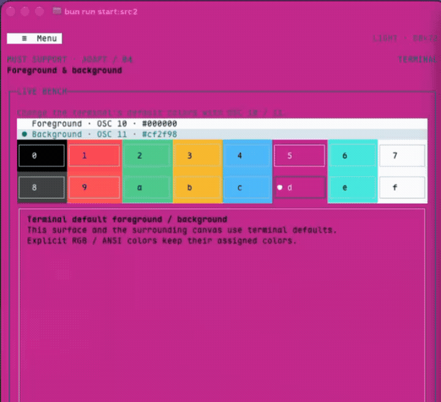

## ANSI 16色パレット

ANSI 16色パレットは、通常色8色と明るい色8色からなる、色番号0〜15のパレットです。色のRGB値そのものはターミナルの設定やテーマによって変わります。

成功・エラー・警告などの役割に色番号を割り当てると、利用者のターミナルテーマに合わせたUIにできます。例えば、次のように使えます。

```tsx
import { RGBA } from "@opentui/core"

return <box>
  <text fg={RGBA.fromIndex(2)}>✓ 保存しました</text>
  <text fg={RGBA.fromIndex(1)}>× 接続に失敗しました</text>
  <text fg={RGBA.fromIndex(3)}>! 変更が未保存です</text>
</box>
```

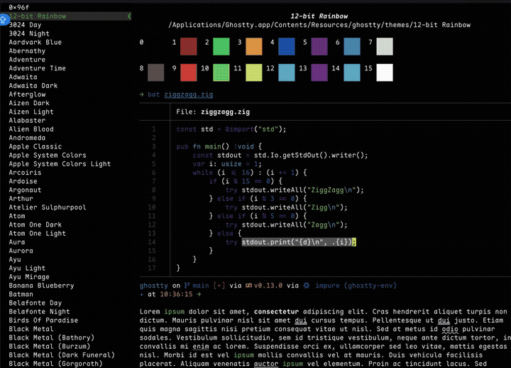

## 入力カーソル

文字の入力位置を示すカーソルは、形状や点滅、色を変更できます。
ターミナルの制御列では、形状はDECSCUSR、色はOSC 12を使います。

OpenTUIでは、次のように指定できます。

```tsx
return <input
  placeholder="ここに入力"
  cursorStyle={{ style: "line", blinking: true }}
  cursorColor="#ff8f8f"
/>
```

入力モードを形で区別したり、背景に埋もれない色にしたりすると、入力位置を見つけやすくなります。

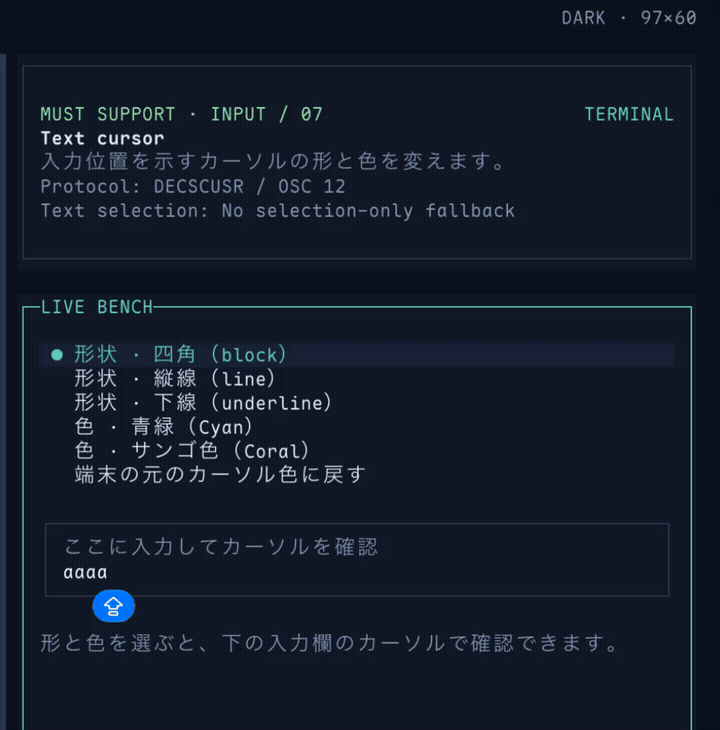

## クリップボード

コードブロックやコマンドの横に「コピー」ボタンがあると、文字をドラッグして選択する手間を減らせます。
OSC 52を使うと、ターミナルを経由してOSのクリップボードへ文章を渡せます。

```tsx
import { useRenderer } from "@opentui/react"

const renderer = useRenderer()
const copy = () => renderer.copyToClipboardOSC52('console.log("Hello!");')
```

クリップボードへの書き込みを許可するかはターミナルの設定に依存します。[OpenTUIのクリップボード](https://opentui.com/docs/core-concepts/clipboard/)

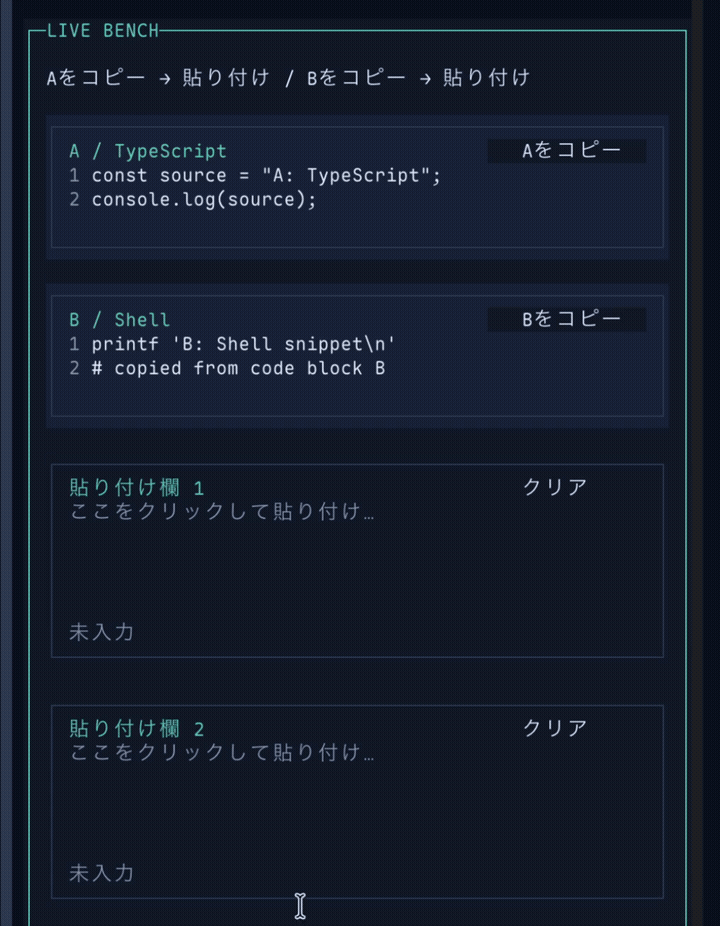

## ポインタ形状

マウスを重ねた場所に応じて、ポインタの形を変えられます。ボタンでは`pointer`、文章の上では`text`、横幅を変えられる境界では`ew-resize`といった使い方ができます。

OpenTUIでは`setMousePointer()`で指定します。ターミナルへ送る制御列はOSC 22です。

```tsx
import { useRenderer } from "@opentui/react"

const renderer = useRenderer()

const setPointer = (style: "pointer" | "default") => {
  renderer.setMousePointer(style)
  renderer.requestRender()
}

return <box
  onMouseOver={() => setPointer("pointer")}
  onMouseOut={() => setPointer("default")}
>
  <text>マウスを重ねてみる</text>
</box>
```

形状名はCSSの`cursor`に近いものですが、表示できる種類はターミナルによって異なります。[kittyのポインタ形状の仕様](https://sw.kovidgoyal.net/kitty/pointer-shapes/)

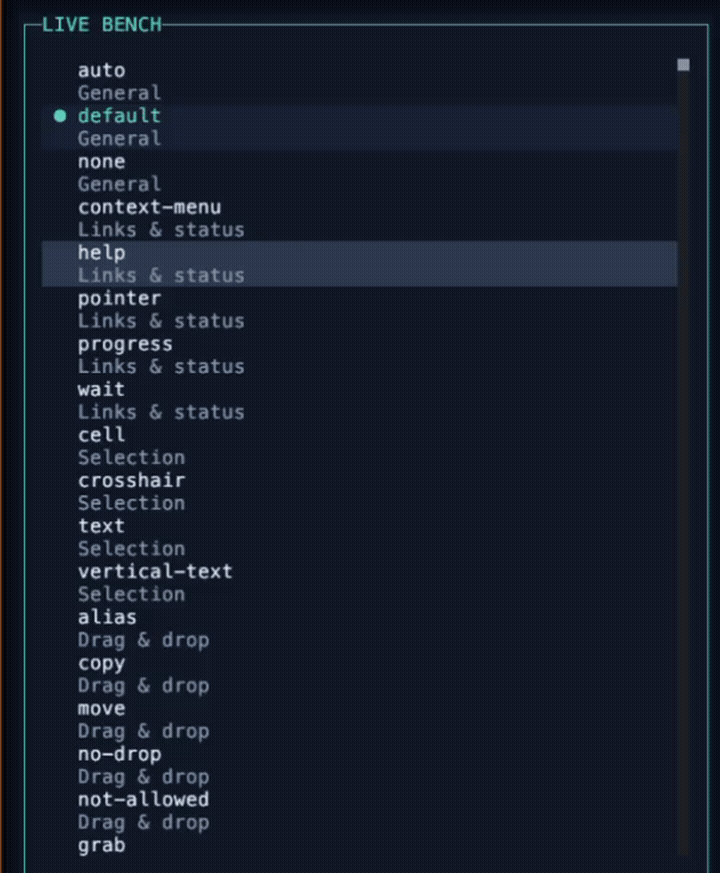

## ハイパーリンク

OSC 8を使うと、URLとは異なる文字列をリンクとして表示できます。ファイル名や「ドキュメントを開く」といったラベルに、リンク先を持たせられます。

OpenTUIでは`<text>`の中に`<a>`を置きます。

```tsx
return <text>
  <a href="https://example.com"><u>ドキュメントを開く</u></a>
</text>
```

リンクの開き方はターミナルによって異なります。GhosttyのmacOS版では⌘クリック、kittyではCtrl+Shiftクリックなどです。通常クリックがTUI側の操作になる場合もあるので、操作方法やコピー用のURLも案内しておくと分かりやすそうです。[Ghosttyの設定](https://ghostty.org/docs/config/reference#link-url)、[kittyの設定](https://sw.kovidgoyal.net/kitty/conf/#mouse-actions)

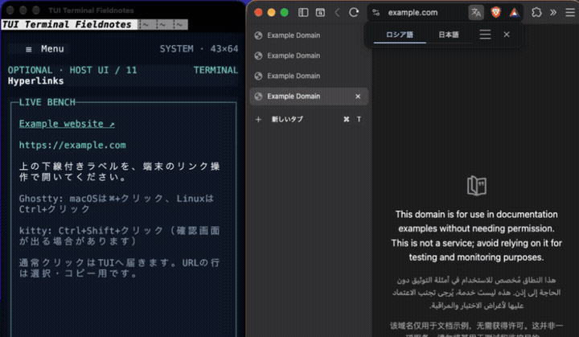

## タイトル

ウィンドウやタブのタイトルに、アプリ名や作業中の内容を表示できます。複数のターミナルを開いている時に見分けやすくなります。
OSC 2はタイトル、OSC 1はアイコン名、OSC 0はその両方を指定します。

```bash
# OSC 0: 両方設定
printf '\033]0;Hello OSC 0\007'

# OSC 1: アイコン名のみ設定
printf '\033]1;Hello OSC 1\007'

# OSC 2: ウィンドウタイトルのみ設定
printf '\033]2;Hello OSC 2\007'
```

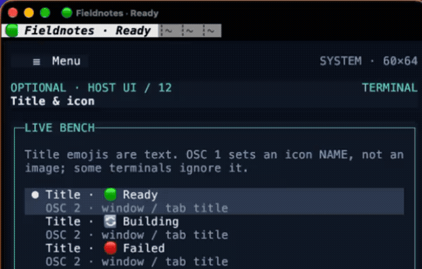

ここでいう「アイコン名」は文字列のラベルで、画像アイコンを設定するものではありません。現行の[kitty](https://github.com/kovidgoyal/kitty/blob/master/kitty/window.py)や[Ghostty](https://github.com/ghostty-org/ghostty/blob/main/src/terminal/osc.zig)では、OSC 1によるアイコン名の変更が実装されていません。GhosttyではOSC 0はOSC 2相当として扱われます。
iTerm2では、OSC 1でタブのタイトル、OSC 2でウィンドウのタイトルを変更できます。ただし、実際の表示は設定によって異なります。

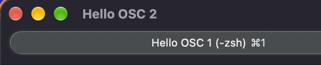

## デスクトップ通知

長い処理の完了や、確認待ちになったことをOSの通知で知らせられます。別のアプリへ移動している時にも気づくことができます。
kittyのOSC 99、iTerm2系のOSC 9、その他OSC 777など、通知はターミナルごとに方式が異なります。

OpenTUIでは以下のように通知を要求できます。

```tsx
import { useRenderer } from "@opentui/react"

const renderer = useRenderer()
const notify = () => renderer.triggerNotification("処理が完了しました", "TUIアプリ")
```

`triggerNotification()`の戻り値の`true`は、通知要求を送信できたことを表します。実際にOSへ表示されるかは、ターミナルやOSの通知設定、フォーカス状態などにも依存します。[OpenTUIの通知](https://opentui.com/docs/core-concepts/notifications/)

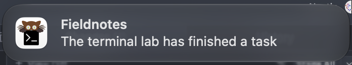

## ローディング表示と進捗表示

対応するターミナルではタブやタスクバーなどに進捗を表示できます。進捗率が分からない処理、進捗率が分かる処理、エラー、一時停止をそれぞれ表せます。

OSC 9;4を使うと、次のように進捗状態をターミナルへ通知できます。

```bash
printf '\033]9;4;3\007'     # 進捗率不明のローディング
printf '\033]9;4;1;50\007'  # 通常の進捗: 50%
printf '\033]9;4;2;50\007'  # エラー状態: 50%
printf '\033]9;4;4\007'     # 一時停止
printf '\033]9;4;0;0\007'   # 表示を解除
```

Ghosttyでは約15秒間更新がないと進捗表示が自動的に解除されるため、長時間の処理では定期的な更新が必要です。
表示場所や見た目はターミナルによって異なります。

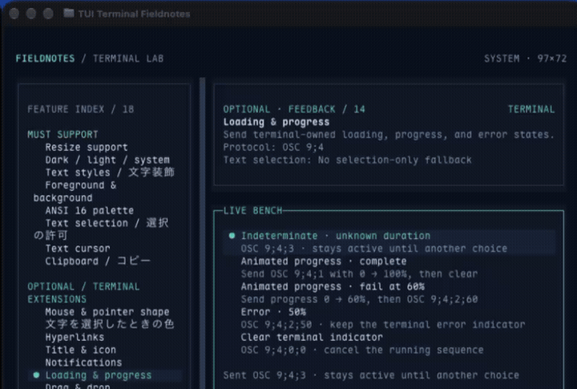

## ドラッグ&ドロップ

ファイルやテキストをターミナルへドラッグ&ドロップできます。

ファイルパスを文字列として貼り付ける方式のほか、MIME形式でデータをやり取りするOSC 72という拡張もあります。OSC 72では、TUIからほかのアプリへのドラッグにも対応しています。[kittyのDrag and Dropプロトコル](https://sw.kovidgoyal.net/kitty/dnd-protocol/)

ファイルの一覧が`text/uri-list`で届いた場合は、例えば次のようにパスへ変換できます。

```ts
import { fileURLToPath } from "node:url"

fileURLToPath("file:///Users/me/My%20File.txt")
// → /Users/me/My File.txt
```

OSC 72の利用にはデータの受信・取得などの処理が必要で、対応するターミナルも限られます。

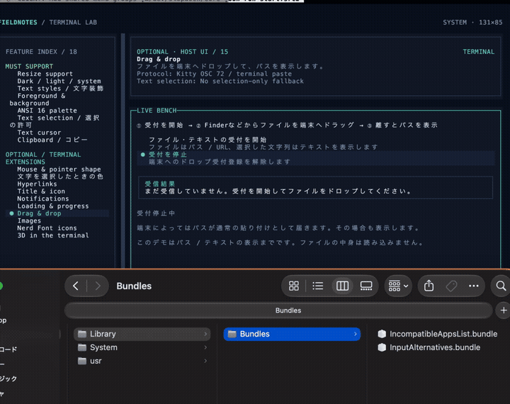

## 画像表示

サムネイルや画像のプレビューもターミナル内に表示できます。大きく分けると、次の2つの描き方があります。

- Kitty GraphicsやSixelなど、ターミナルの画像表示プロトコルを使う方法
- 色付きのUnicodeブロック文字を並べて、セル単位で画像を表現する方法

OpenTUIでは`protocol="auto"`にすると、対応状況に応じてKitty、Sixel、Unicodeブロックから描画方式を選びます。

```tsx
return <image
  source="./sample.png"
  protocol="auto"
  fit="fit"
  style={{ width: 40, height: 12 }}
/>
```

ブロック文字による描画は細部が粗くなりますが、画像プロトコルが使えない場合の代替にもなります。

https://opentui.com/docs/components/image/

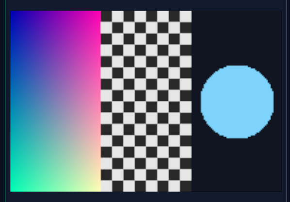

## Nerd Fontsとアイコン

Nerd Fontsは、開発ツールやファイル種別などのアイコンを追加したフォントです。ターミナル側で対応するフォントを選ぶと、文字としてアイコンを表示できます。

```tsx
return <text>{"\uE0A0"} main</text>
```

グリフを含まないフォントだと表示が欠ける場合があるので、アイコンだけに意味を持たせず、文字ラベルも添えておきたいです。

https://www.nerdfonts.com/

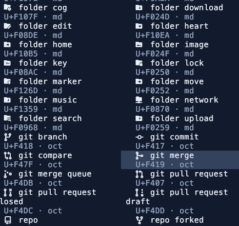

## ターミナル内3D

立方体などを回転させて、ターミナルのセルへ描くこともできます。

OpenTUIには、Three.jsのWebGPUレンダラーをOpenTUIのバッファへ接続する`@opentui/three`もあります。こちらはBunやWebGPUを利用するため、実行環境の対応が必要です。

https://opentui.com/docs/reference/three/

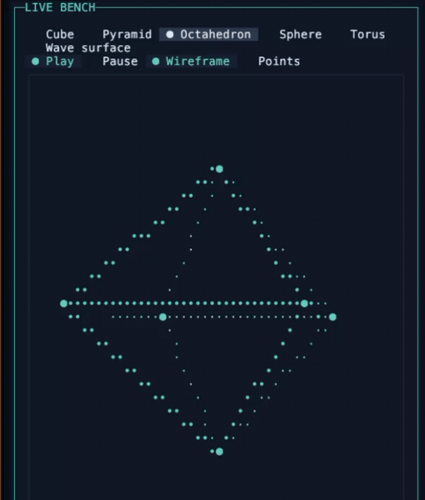

# 取り入れるときに考えておきたいこと

- マウス操作だけでなく、Tab・矢印・Enterなどのキーボード操作も用意する
- 色やアイコンに加えて、文字ラベルや記号でも状態を伝える
- 未対応の場合に備えて、手動コピーやURL表示などの代替を用意する
- 変更したターミナルの配色やカーソルを終了時に元に戻し、進捗表示なども解除する

# おわりに

今回は、TUIアプリで対応してみたいターミナル機能やUI/UXについて紹介しました。
小さい工夫でも、情報を見分けやすくなったり操作が楽になったりするので、用途に合うものから取り入れてみてください!
